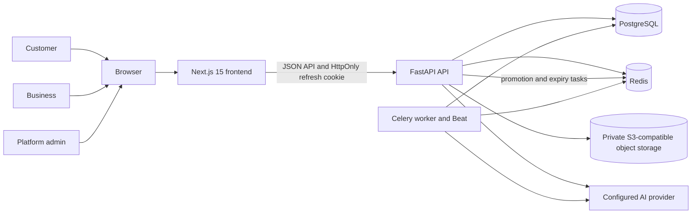
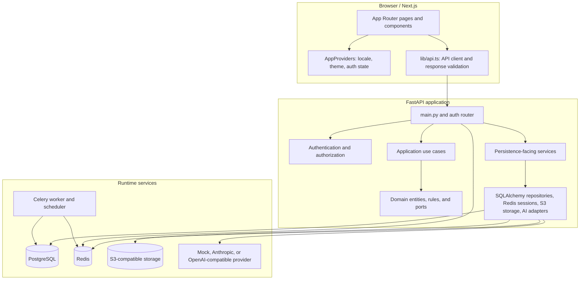
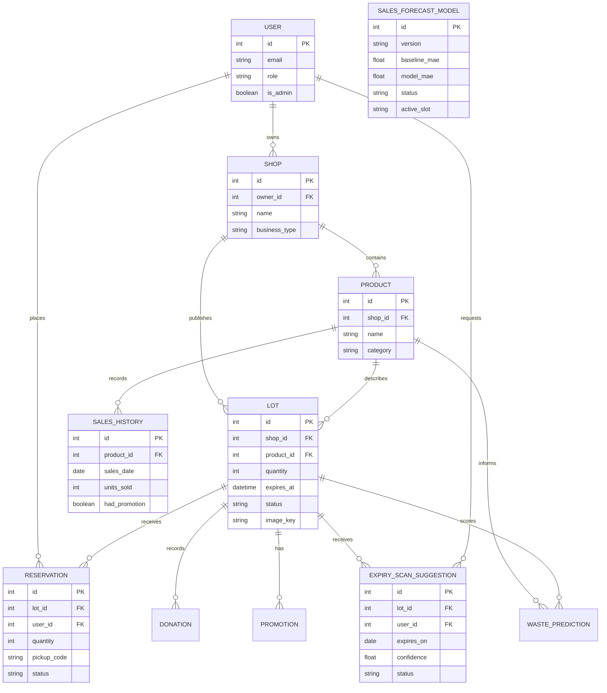

# SobraCero architecture

## System context



Local development uses Docker Compose with PostgreSQL, Redis, LocalStack,
FastAPI, Celery worker/Beat, and Next.js. LocalStack implements the S3 API for
development; production storage must be configured separately.

## Main components



The backend is layered in part, but not every route has been migrated to a
dedicated application use case. `main.py` remains the composition and HTTP
entry point for several workflows. SQLAlchemy models are persistence objects;
Alembic migrations are the source of truth for schema creation and evolution.

## Structured AI and expiry review

```mermaid
sequenceDiagram
    actor Business as Business user
    participant Web as Next.js
    participant API as FastAPI
    participant Store as Private object storage
    participant AI as Structured AI provider
    participant DB as PostgreSQL

    Business->>Web: Request date scan for an owned lot
    Web->>API: POST /api/v1/lots/{id}/expiry-scans
    API->>API: Authenticate, authorize owner/admin, enforce request limit
    API->>Store: Download private image
    Store-->>API: Image bytes and MIME type
    API->>API: Sanitize image and enforce size/pixel limits
    API->>AI: Request schema-constrained expiry-date result
    AI-->>API: Validate date and confidence with Pydantic
    API->>DB: Save awaiting_confirmation or unreadable suggestion
    API-->>Web: Return suggestion; never change lot expiry automatically
    Business->>Web: Explicitly confirm or reject suggestion
    Web->>API: POST confirm/reject endpoint
    API->>DB: Persist decision; confirmation applies accepted date
    API-->>Web: Return updated suggestion
```

AI recommendations are qualitative. Prices, stock, risk scores, and inventory
state are determined by application code or the forecast model rather than by
free-form AI output.

## Data model



`WASTE_PREDICTION` is a persisted result associated with a product and lot.
`SALES_FORECAST_MODEL` stores the JSON artifact, time-ordered evaluation
metrics, and the active-model marker. Some lifecycle details, such as promotion
variants, are omitted from the diagram for readability.
