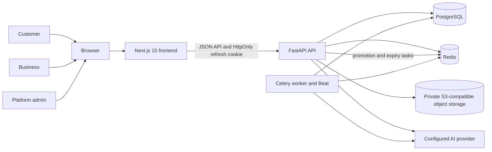
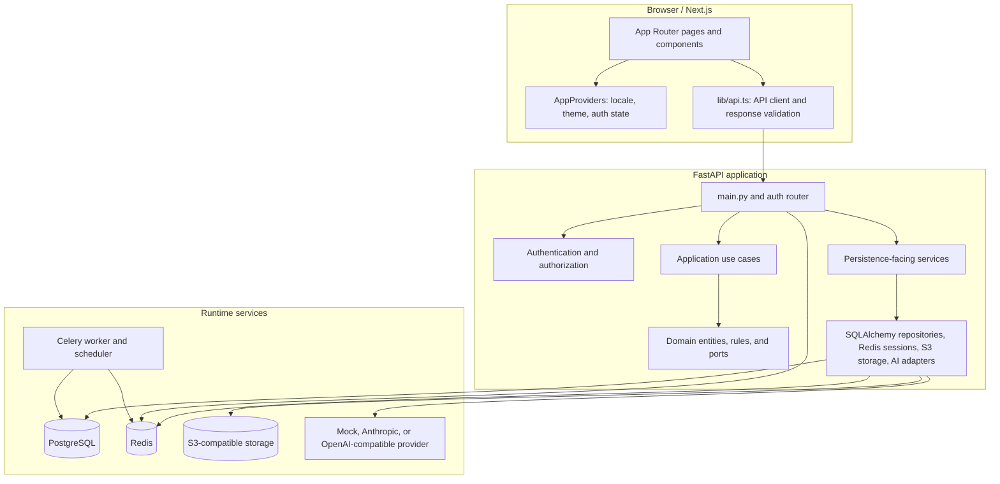
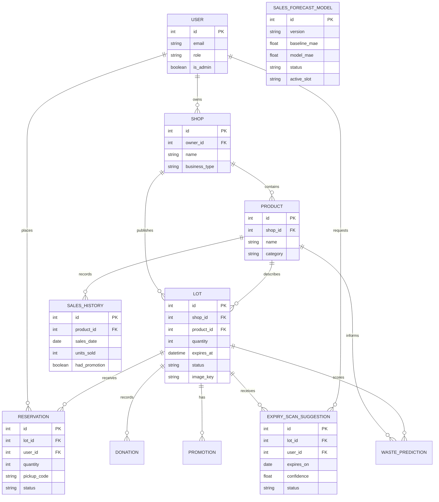
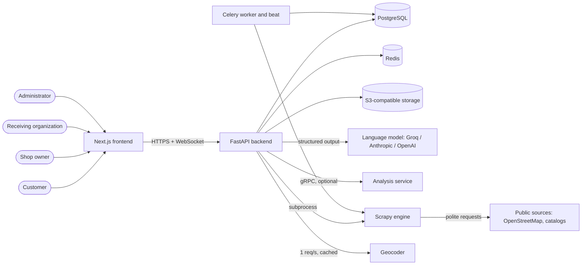
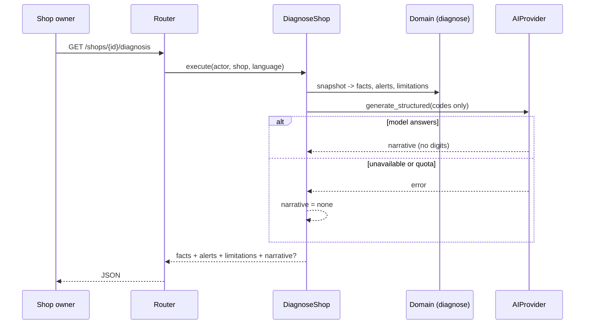
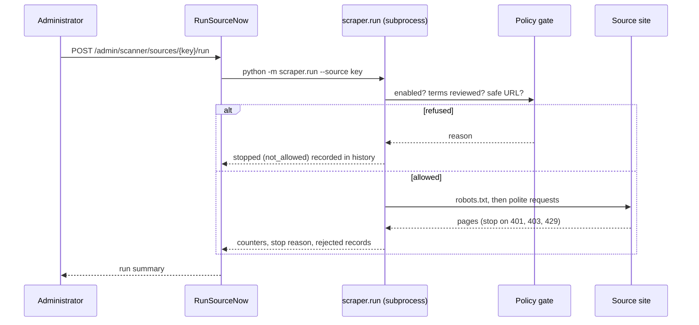
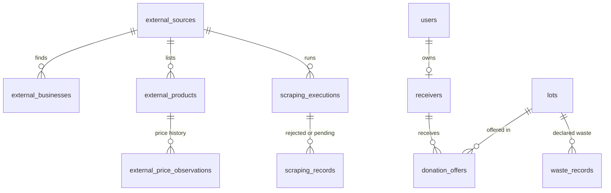

# SobraCero architecture

## System context



Local development uses Docker Compose with PostgreSQL, Redis, LocalStack,
FastAPI, Celery worker/Beat, and Next.js. LocalStack implements the S3 API for
development; production storage must be configured separately.

## Main components



The backend is layered in part, but not every route has been migrated to a
dedicated application use case. `main.py` remains the composition and HTTP
entry point for several workflows. SQLAlchemy models are persistence objects;
Alembic migrations are the source of truth for schema creation and evolution.

## Structured AI and expiry review

```mermaid
sequenceDiagram
    actor Business as Business user
    participant Web as Next.js
    participant API as FastAPI
    participant Store as Private object storage
    participant AI as Structured AI provider
    participant DB as PostgreSQL

    Business->>Web: Request date scan for an owned lot
    Web->>API: POST /api/v1/lots/{id}/expiry-scans
    API->>API: Authenticate, authorize owner/admin, enforce request limit
    API->>Store: Download private image
    Store-->>API: Image bytes and MIME type
    API->>API: Sanitize image and enforce size/pixel limits
    API->>AI: Request schema-constrained expiry-date result
    AI-->>API: Validate date and confidence with Pydantic
    API->>DB: Save awaiting_confirmation or unreadable suggestion
    API-->>Web: Return suggestion; never change lot expiry automatically
    Business->>Web: Explicitly confirm or reject suggestion
    Web->>API: POST confirm/reject endpoint
    API->>DB: Persist decision; confirmation applies accepted date
    API-->>Web: Return updated suggestion
```

AI recommendations are qualitative. Prices, stock, risk scores, and inventory
state are determined by application code or the forecast model rather than by
free-form AI output.

## Data model



`WASTE_PREDICTION` is a persisted result associated with a product and lot.
`SALES_FORECAST_MODEL` stores the JSON artifact, time-ordered evaluation
metrics, and the active-model marker. Some lifecycle details, such as promotion
variants, are omitted from the diagram for readability.

## Food-intelligence phase (2026-11)

This phase added a place directory and map, a data collection engine (the Scanner), donation
receivers, the daily shop diagnosis and declared waste. Dependencies keep pointing inward:
presentation, then application, then domain; infrastructure implements the interfaces declared
inside, and one composition root (`app/dependencies.py`) wires the concrete classes.

### System context with the new parts



### Components in the backend

```mermaid
flowchart TB
  subgraph presentation
    Routers[routers + schemas + error handlers]
  end
  subgraph application
    UseCases[use cases: one execute() each]
    Ports[ports: repositories, AI, geocoder, runner]
  end
  subgraph domain
    Rules[entities, value objects, rules, typed exceptions]
  end
  subgraph infrastructure
    Repos[SQLAlchemy repositories]
    Adapters[AI, geocoding and runner adapters]
  end
  Routers --> UseCases --> Rules
  UseCases --> Ports
  Repos -.implements.-> Ports
  Adapters -.implements.-> Ports
```

| Area | Domain rules | Notes |
| --- | --- | --- |
| Marketplace | `entities`, `rules`, `services.py` (first generation) | Atomic conditional updates; concurrency tests |
| Rescue | `rescue`, `simulation`, `timeline`, `impact` | Human approval, audit events, stale-plan protection |
| Discovery | `discovery`, `discovery_evaluation` | Feasibility by window, budget and distance |
| Donations | `receivers` | Hard rules first, then a fair order |
| Geography | `places`, `geocoding`, `opportunities` | Affiliation is never inferred |
| Collection (Scanner) | `external_data`, `collection`, `url_policy`, `source_policy` | Policy gate before any request |
| Intelligence | `diagnosis`, `waste` | Deterministic; the model only words |

### Daily diagnosis flow



### A Scanner run



### Data model of the new tables



External data lives in its own tables and never becomes a lot, an offer or an affiliate.

### Frontend

Next.js App Router with next-intl (en/es), light/dark/system theme, Zod validation of every API
response and one module (`lib/api.ts`) that talks to the backend. Rendering per route is in the
frontend's `docs/rendering.md`: static, server-rendered, streaming, incremental regeneration and
client-rendered pages, each chosen for freshness and privacy.

### Deployment

Railway runs the backend, the frontend, PostgreSQL and Redis; a worker and a scheduler (Celery) are
optional services that run lot expiry and due Scanner sources. See `deployment.md`. The backend
image contains Scrapy so the same image can run the engine; the web process never imports it.

### Security

Argon2/bcrypt passwords, short-lived access tokens with a rotating refresh cookie, ownership checks
in use cases, per-client rate limits on authentication, AI, geocoding and pickup, SSRF protection for
source addresses, a terms-review gate for external data, and typed errors mapped centrally to
`{ code, message_key, details? }`. See `security.md`.
